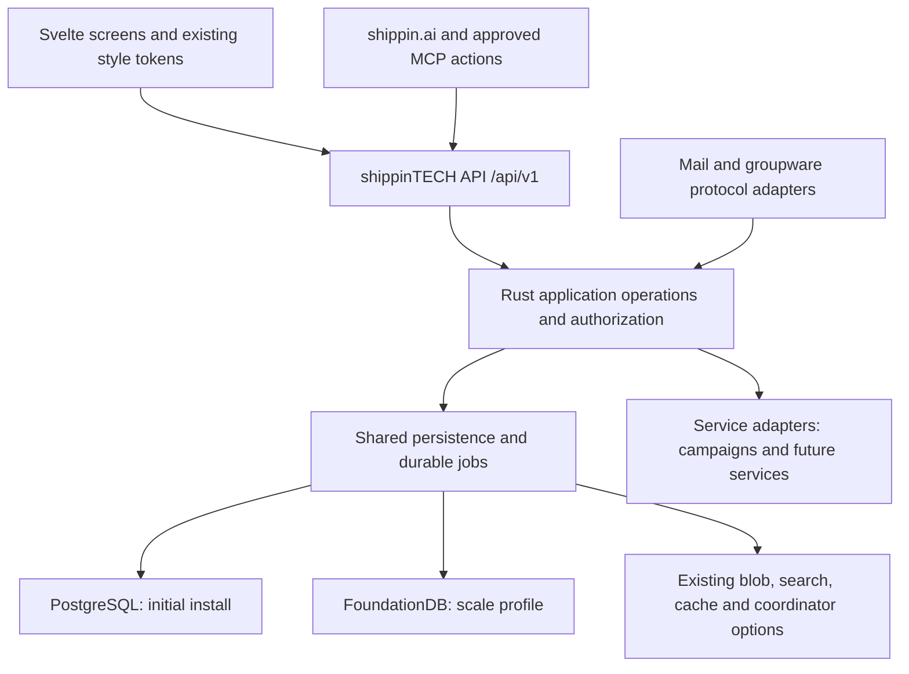

# shippinTECH alpha execution plan

Owner direction, refreshed 2026-11-22. **This is the single execution order.** It supersedes
older sequencing in `PLAN.md`, porting work packages, dated plans and Cursor rules.
[REGRESSION.md](REGRESSION.md) defines acceptance; [RELEASE.md](RELEASE.md) controls
tags. This is pre-release engineering on disposable installs.

## 1. The result being built

One shippinTECH product: the existing Svelte UI and style tokens drive owned Rust
application services through `/api/v1`. PostgreSQL is the initial database.
FoundationDB remains the scale option behind the same application/storage boundary.
Other existing storage capabilities remain available. The choice of database must
not change which mail, admin, security or collaboration features are available.

All existing capabilities remain in scope, including capabilities previously sold
as Enterprise. There is no permanent upstream private API, compatibility shim or
old UI requirement. Fresh pre-release installs are allowed; preserving upstream
private API shapes and historical data layouts is not an acceptance requirement.
Standard SMTP, IMAP, POP3, JMAP, DAV, ManageSieve, OAuth and SCIM interoperability is
part of the product. New shippinTECH data still needs durability, backup and recovery.
PostgreSQL-to-FoundationDB transfer is a product scaling capability, not upstream
compatibility work.

Reuse the Svelte and shippinTECH Rust implementations already written. Port the
missing behavior and reconnect callers; do not restart those features from zero.
Do not reduce capabilities by compiling out Enterprise, substitute successful
stubs, or count renaming as a completed port. Permitted third-party libraries can
remain dependencies with their notices; ownership of the product does not require
rewriting every library authored by someone who also worked upstream.

## 2. Current audited baseline ? 2026-11-22

Audit anchor: `19c4409e97a89ab1c40716dab49ed9ee59d5dd32`. This refresh replaces the
stale November 21 status table, not the existing product or its implementation.
The executable cards are [roadmap/execution.csv](roadmap/execution.csv); every
historical review is assigned in [current-review.csv](roadmap/reconciliation/current-review.csv).
The evidence snapshot is [current-audit.json](roadmap/reconciliation/current-audit.json).

| Item | Verified observation / remaining work |
| --- | --- |
| Git | Main is pushed and clean at the audit anchor; one worktree, no active stash. The retained remote branch has 0 unique commits and is 14 behind main. No branch merge is missing. |
| All available history | Existing 53 historical sources plus current main cover all 257 stored commits; zero uncovered commits. The 32 checkpoint refs and both dropped stashes remain accounted for. Nothing was pruned or blanket-applied. |
| Absorption | All 3,193 historical review units now have current blob comparison and a specific execution-card assignment. Only 37 have an exact blob elsewhere/currently. All behavioral dispositions remain open; assigning a task is not reviewing its behavior or proving authorship. |
| Committed work | `7553600` People/API consumer; `e952af3` PostgreSQL-first installer/recovery plumbing; `1b39550` installation defects; `19c4409` reserved identity domain/root separation. These are already in main; do not recreate or recommit them as pending work. |
| CI / image | [Check](https://github.com/shippin-tech/shippinTECH/actions/runs/45045930859) and [candidate build](https://github.com/shippin-tech/shippinTECH/actions/runs/45059518055) passed for the anchor. Candidate `ghcr.io/shippin-tech/shippintech-scale:sha-19c4409e97a89ab1c40716dab49ed9ee59d5dd32`, Linux amd64; no release change. |
| Bounded tests | 164 common + 36 HTTP unit tests, 289 UI units, 13 mocked browser tests, full available web/deploy checks including Linux relay; 3 authentication/bootstrap/lifecycle tests each on PostgreSQL and SQLite. These are not whole-product or packaged multi-tenant proofs. |
| Test-profile limitation | `enterprise/config.rs` supplies a synthetic license under `test_mode`; normal builds without a key return None. `common/config/mod.rs` then clears directories and downgrades some composite storage/telemetry. Packaged no-license tests are mandatory for D1/D2/D3/D9. |
| Svelte | Existing UI is the base. Its 57-entry source inventory records 3 representative proofs, 29 partial, 4 runtime-replaced, 17 retained assets and 4 pending; this is not full workflow parity. Keep the existing styles/screens. |
| API | People and other admin consumers use `/api/v1`, but `registry_rest.rs` and setup helpers still dispatch private JMAP methods internally. D10 is an application-operation/schema cut, not another URL rename. |
| Installation claim | System identity is implemented; installer-to-owner claim is not. Installation still prints a temporary key, requires login, creates root, and asks for login again. D0 defines the minimal replacement. |
| Source separation | Existing own modules, unresolved application origins, an AGPL Sieve dependency and the upstream spam-rule feed are distinct boundaries. No changed-line percentage or renamed EE symbol proves license independence. |

## 2a. Authored execution contract

This planning pass changes documents and audit data only. Use the existing H0,
A0?A6 and D1?D11 identifiers; D0 names owner claim, D12 external runtime/build
inputs, D13 application-source closure, U1 whole UI parity and Q1 qualification.
The 17 cards name inputs, reuse targets, required authored work, proof and completion.

1. **H0: absorb existing work.** Resolve the 3,193 source/behavior reviews by packet;
   record retained equivalents or exact recovery, never a blanket branch overwrite.
   Start the runtime review with the D1/D2/D3/D9 entries and the setup D0 entries.
   Do not turn their automatic path-based task routing into a completed review.
2. **Minimal operational correction: D0.** Installer claims the permanent owner using
   local installation authority and a chosen password; no manual temporary-login
   journey. This is bounded setup work, not a fleet/control-plane redesign.
3. **First independence cut: D1 + D2 + D3 + D9 together.** Own capability/configuration,
   directories/permissions/quotas, telemetry and storage composition. They are one
   retirement boundary: do not remove old configuration before its consumers pass.
4. **Finish existing ports: D4?D8.** Masks, recovery, templates/branding, AI spam/script
   calls and SCIM. Preserve wider baseline operations beyond the current own subsets.
5. **D10 + U1:** direct Rust application operations and owned schema generation;
   move existing Svelte/MCP callers per operation family, preserve standard protocols,
   then remove private admin dispatch. No permanent compatibility layer.
6. **D11?D13 alongside these cuts:** independent filtering, owned external artifacts,
   and per-component source closure. Resolve actual origin before scheduling a
   rewrite. Keep permitted libraries with notices; do not rewrite by author identity.
7. **Q1:** exact packaged-image proof on PostgreSQL and FoundationDB plus retained
   backend coverage, independent mail clients, tenant isolation, restart/recovery,
   backup/restore and scale transfer. Historical green rows are not candidate proof.

H0 remains an open absorption gate; this refresh does not silently waive it. A0 is
already committed. In each implementation slice, required tests run before the
superseded path is removed; the final product has one API, not two supported layers.
Webmail is already in scope. Listmonk/campaign adapters and upstream-reference
improvements follow separation and cannot displace any current capability.

## 3. Package definitions and completion gates

Sections 2/2a and `roadmap/execution.csv` are the current status and execution
sequence. The dated sequencing notes below are retained history, not instructions
to recommit completed A0 work or expand installation before feature separation.

**Owner resumption, 2026-11-21:** the subsequent instruction authorizes committing
the pending People/API changes and implementing PostgreSQL self-host deployment now.
That bounded A0/A1 work takes precedence over the earlier coding freeze and installer
deferral below. It does not close H0's historical behavior reviews or the independence
gates. Reuse the existing backend; preserve FoundationDB and other capabilities.

**H0 — reconcile existing work before any new product code.** Follow
[R0-R8](roadmap/reconciliation/README.md): every source has a disposition and every
non-identical historical version has a review packet. Resolve retained equivalents
and necessary recovery before resuming implementation. Do not merge whole snapshots
or treat changed/absent historical paths as automatically superseded. The owner has
resumed the bounded A0/A1 work above; H0 remains open for the broader separation work.

**Priority correction after the owner's stop instruction:** the package IDs below
are stable references, not numeric execution order. Installation work does not
establish source independence. The separation path is:

1. After H0 closes, use the [remaining dependency map](roadmap/independence.md) to connect each old
   runtime caller to existing shippinTECH code and name missing behavior. That map
   is required before resuming product edits; known caller paths are recorded now.
2. Once implementation resumes, commit the already-tested A0 consumer diff with its
   live limitation stated. Execute **A2**: complete the existing feature ports and
   eliminate runtime reliance on old entitlement/configuration paths. Use only the
   minimal PostgreSQL test setup required to exercise them; do not expand installers.
3. Execute **A3**: own the schema/generator and direct Rust application operations,
   move consumers together, then remove private JMAP dispatch. Finish obsolete A0
   private-call helpers as part of this cutover.
4. Close **A5** alongside those ports: record source decisions per actual component,
   retain existing own work, replace Sieve and other confirmed remaining inherited
   application components. A5 is a required gate, not a later research bucket.
5. **A4** supplies full feature/protocol proof throughout each cutover. No missing
   baseline capability is deferred merely because its old route can be removed.
6. Complete **A1** self-host installation and **A6** whole-product qualification
   after the separation work is closed. Managed hosting runs that same product.

This order supersedes the previous "A0, then installer" next-task instruction.
PostgreSQL-first, FoundationDB scaling and storage versatility remain requirements.
No claim that all remaining code is a small port is established by the current audit.

Work on `main`, with bounded commits and their evidence. No PRs, release tags or
unrelated refactors. Each package ends with a reviewable result and an updated
capability report. Do not move an unverified row to Done.

### A0 — Finish and commit the pending Svelte API consumer

**Files:** `ui/src/lib/shippin/people/team.ts`, `ui/src/lib/contract/registry.ts`,
`ui/src/lib/adapter/{registry-facade,jmap,action-call,bootstrap-call}.ts`, associated
`ui/test/`, `ui/test-live/`, `ui/scripts/prove-portal-{actions,bootstrap}.ts`.

1. Review the pending diff: paged people/domain reads, id-only account creation,
   group membership, deletion, stale-write errors and credential field patches.
2. Remove obsolete private-call builders and update their proof scripts. Keep
   standard protocol adapters. Unknown admin objects must fail without fallback.
3. Run the full web gate, not just the new tests. Commit the validated pending API
   work separately from this plan. Its live verification stays open until A1.

**Done:** all applicable web checks pass; active Svelte admin operations use the
owned API; no private transport fallback; commit ID and remaining live checks recorded.

### A1 — Make PostgreSQL the actual runnable baseline

**Files:** `crates/main/Cargo.toml`, `Dockerfile`, `Dockerfile.fdb`,
`deploy/local/{compose.yaml,start.ps1,bootstrap.py,refresh.ps1,README.md}`,
`install.sh`, `deploy/{compose.yaml,server.env.example,README.md}`;
existing `crates/store/src/{build,registry,backend/postgres}` and
`crates/common/src/manager/{boot,defaults}.rs` only where boot wiring requires it.

1. Add PostgreSQL to the common shipped build; retain FoundationDB and existing
   optional stores. Set PostgreSQL as the new-install default with explicit scale
   selection. Do not create a second engine or a different feature edition.
2. Generate a valid PostgreSQL store configuration at install time, resolve secrets
   through existing mechanisms, and complete the D0 installer owner-claim flow.
   Startup must select the requested store explicitly and fail clearly if unavailable.
3. Local default starts PostgreSQL without requiring FoundationDB. Keep an explicit
   FoundationDB scale profile with the same UI, API, mail behavior and service options.
   Update install docs and scripts together; a compiled driver alone is insufficient.
4. Run first-run, admin/People/password, SMTP-to-webmail and restart tests on the exact
   candidate. Capture commit, image ID, backend, fixtures and results. Record a usable
   baseline for subsequent Rust ports; failures are fixes to make here, not waivers.

**Done:** a fresh disposable PostgreSQL install reaches every existing feature surface;
its live suites run; restart retains synthetic mail/settings. FoundationDB support
still builds. No FDB repair detour is required to establish the PostgreSQL baseline.

### A2 — Finish the existing shippinTECH feature ports

**Files:** `crates/common/src/shippin/`, `crates/http/src/shippin/`,
`crates/services/src/alerts.rs`, their call sites in `email`, `groupware`, `directory`,
`store` and `http`; old `crates/common/src/enterprise/`,
`crates/services/src/task_manager/scheduler.rs`,
`crates/jmap/src/registry/mapping/principal.rs`,
`crates/common/src/cache/directory.rs`, `crates/main/src/main.rs`.

For each row: identify active callers, route them to the existing own implementation,
port missing behavior, run the stated real workflow, then remove the superseded path.
Remove dead license validation, renewal scheduling and licensed-account caps as part
of that cutover. Preserve real role, tenant, abuse and quota limits. Merely making
`is_enterprise_edition()` return true is not completion.

| Feature | Existing implementation to extend | Behavior that closes the row |
| --- | --- | --- |
| Metrics, traces, alerts | `shippin/stats.rs`, `shippin/trace_history.rs`, own alert modules | Live and stored data, retention, filters, email/webhook delivery; one collector and scheduling path, no duplicate alerts |
| Recovery and masked addresses | `shippin/recover.rs`, `shippin/masks.rs` | Delete/restore with bytes and permissions; mask creation, delivery, disable and all previously supported uses |
| Tenancy and identity | `shippin/orgs.rs`, `shippin/sso.rs`, `shippin/provisioning.rs`, own SCIM route | Tenant walls, delegated administration, quota enforcement, domain directories, provisioning and refusal behavior; current OIDC/SCIM subset must not hide missing baseline operations |
| Branding and calendar templates | `shippin/brand.rs`, `shippin/calendar_templates.rs` | Domain branding, reminder/invitation content and RSVP behavior through the actual mail/groupware callers |
| AI, spam and Sieve prompts | `shippin/ai.rs`, `spam-filter`, `common/src/scripts` | Existing provider configuration drives classification and Sieve prompts; timeout/failure/disabled behavior tested; assistant success alone does not close this |
| Storage features | `store/src/backend/{postgres,foundationdb,composite}`, `coordinator` | SQL replicas, blob/cache sharding and cluster behavior remain available with correct writes, reads, quotas and recovery |

**Done:** every remaining old feature consumer has an owned replacement and passing
behavior evidence. No license stub, renewal task or upstream entitlement is needed
to exercise the supported features. Reuse historical F0–F11 tests and rerun on the
candidate PostgreSQL test fixture; full installer packaging is not a prerequisite.

### A3 — Own the Rust contract and remove private JMAP dispatch

**Files:** `crates/http/src/api/{v1,registry_rest}.rs`, `crates/jmap/src/registry/`,
`crates/registry/src/{schema,types}`, `resources/schema/schema.json.gz`,
`api/{DESIGN.md,v1/openapi.yml}`, `ui/scripts/emit-registry.ts`,
`ui/src/lib/contract/`, `mcpl/`.

1. Use the existing `/api/v1` operations as the starting contract. Define checked-in
   shippinTECH schema sources and reproducible generators. Preserve capabilities,
   required fields, patch semantics, errors and concurrency; private wire shapes may change.
2. Implement the application operations directly in Rust: validation, authorization,
   transactions, service calls and auditing. `/api/v1/registry` must stop constructing
   `x:*` JMAP requests. Standard JMAP and other protocols call the same domain operations.
3. Generate the Svelte client, Rust models, OpenAPI and MCP action declarations from
   owned sources; move every product caller in the same slice. Do not maintain two APIs.
4. Remove private extension routes, unused schemas and bundles after their callers
   move. Test refusal/absence of retired routes and ordinary protocol interoperability.

**Done:** a clean checkout regenerates contracts; UI and MCP invoke the same authorized
operations; admin execution does not dispatch through the old private JMAP layer;
full CRUD/actions/security tests pass, including partial credentials and stale edits.

### A4 — Close full Svelte and protocol capability parity

**Files:** `ui/src/lib/shippin/`, `ui/src/lib/portal/`, `ui/src/lib/token/`,
`ui/src/routes/`, `ui/porting/`, `ui/e2e-live/`, `ui/test-live/`,
`deploy/local/verify*.py`, `tests/src/{smtp,imap,jmap,webdav,scim,system,store,cluster}`.

Use the coverage table below. Finish actual missing workflows: Sieve editor and
activation, typed settings where generic CRUD loses behavior, webmail search,
independent IMAP/POP3/DAV/ManageSieve/OAuth checks, accessibility and mobile flows.
Retain webmail compose/reply/forward, drafts, attachments, calendars, contacts, files,
Docs, administration and existing integrations. Reuse style tokens; this is not a
visual redesign. Inventory entries need workflow proof, not just a reachable route.

**Done:** each existing capability has candidate-image evidence. Implement or explicitly
leave open unfinished promises such as the Microsoft server adapter; never silently
call a mock a real integration or remove the screen to make a test pass.

### A5 — Close the remaining source and dependency separation

**Files:** `provenance/`, `scripts/provenance.py`, `Cargo.toml`, `Cargo.lock`,
crate manifests, `crates/{smtp,imap,pop3,jmap,dav,scim,managesieve,email,groupware,
common,directory,store,coordinator,services,registry,types,trc,utils,nlp}` and protocol
crates; exact replacement files are selected by the source decisions below.

Produce a per-file/per-component decision: **existing shippinTECH work: keep;
permitted dependency: retain with notices; confirmed remaining inherited application
implementation: replace; uncertain origin: unresolved**. Validate earlier rewrites
before adding them to the replacement queue. A squashed commit or path name alone
cannot decide this. This accounting runs alongside A2–A4; it must not delay the
already identified D1–D11 work in the separation map, and must close before the
finished product is described as independent.

The executable replacement order is: owned feature wiring (A2), private application
contracts/schema (A3), filtering runtime where still required, then remaining mail,
groupware, persistence and infrastructure components actually identified as inherited.
Each replacement gets its exact files, observable specification and affected suites
before coding. Replace only the identified component; retain the shared storage and
protocol behavior. `roadmap/independence.md` records those decisions and removal commits.

`sieve-rs` is a concrete remaining dependency boundary with user and MTA-stage
integration; retain the full extension/function/plugin inventory when replacing it.
Do not replace MIME, auth, parser or utility packages solely because of their author.
Any such dependency retained is attributed as a dependency, not claimed as our code.

**Done:** every shipped application source/generated artifact has a resolved origin;
all required replacements have passing behavior evidence and removal commits;
no forbidden upstream source, binary, runtime service or build download remains.
The present inventory does not yet establish how many files this requires. Removing
EE gates, translating to Svelte or changing headers cannot by itself close this gate.

### A6 — Prove a complete alpha and the PostgreSQL-to-scale path

**Files:** `scripts/{regression.py,engine-suite.sh}`, `.github/workflows/check.yml`,
`tests/`, `deploy/`, `roadmap/capabilities.csv` and its generator, `RELEASE.md`.

1. Make the regression runner execute the actual required matrix: PostgreSQL baseline,
   FoundationDB scale, existing supported-backend checks, both default and scale builds.
   Current runner only selects RocksDb/Sqlite and needs correction. Supply Docker/service
   prerequisites and `STORE`/`COORDINATOR`; timeouts, ignored and missing tests stay visible.
2. Run full UI, live contracts/browser, independent protocol and engine suites on a
   named candidate. Fix failures. Record historical results separately from this run.
3. Prove new-product backup/restore and PostgreSQL-to-FoundationDB transfer with synthetic
   messages, attachments, accounts, ACLs, keys and jobs. Pause writes for the first
   supported transfer if needed; verify counts/content and restart the same application.
   Do not promise automatic online scale migration before it is implemented and tested.
4. Exercise unavailable storage, exhausted disk, interrupted jobs and restart. Requests
   must have bounded failure, useful errors and health reporting, followed by recovery.
5. Record throughput, latency and memory fixtures and acceptance thresholds before
   evaluating the candidate. Build/run the server on Linux amd64 and arm64. The earlier
   desktop-commander platform request was withdrawn and is not a new client project.

**Done:** A0–A5 closed; all capability tests pass on the candidate or a specifically
identified unfinished feature remains a blocker; fresh install and scale transfer
work; release rows are reconciled with evidence. No global zero-regression or
independence claim is made from a green build alone. No `v*` tag before RELEASE closes.

### Commands and evidence locations

These are execution commands, not a claim that they have all passed. Rust scale
checks need the FoundationDB client/build prerequisites. Live commands require the
candidate stack and synthetic accounts; credentials stay in ignored local files.

| Check | Command / evidence |
| --- | --- |
| Whole web gate | From root: `python scripts/regression.py --only web`; on Windows use Git Bash for POSIX deploy checks, and report any POSIX-only check not run |
| Focused Svelte diagnostics | From `ui`: `npm run check`, `npm test`, `npm run build`, `npm run test:browser`; the full web gate also checks contracts, branding, inventory and MCPL |
| PostgreSQL build | `cargo check -p shippin-tech --locked --no-default-features --features "postgres enterprise"` |
| Shared scale build | `cargo check -p shippin-tech --locked --no-default-features --features "postgres scale enterprise"`; retain other supported feature checks |
| Live owned contract and browser flows | From `ui`: `npm run test:contract-live`, `npm run test:live`; root `python scripts/regression.py --only live` also runs the existing local verifier scripts |
| Engine matrix | A6 first fixes `scripts/regression.py` and `scripts/engine-suite.sh` to select PostgreSQL/FoundationDB and their Cargo features/services; then `python scripts/regression.py --engine`. The current command alone does not cover that matrix |
| Results | `REGRESSION-RESULTS.md`, `roadmap/regression-results.json`, per-run logs, and capability-specific fixtures; record commit/image/backend, passed/failed/ignored/not-run counts and failure causes |
| Source/contract closure | Regeneration checks plus a clean isolated build; inspect dependency graph and active routes for the specifically retired sources/methods. Do not use a branding string search as the ownership test |

## 4. Every capability has a destination

IDs refer to [the existing ledger](roadmap/capabilities.csv). Its `verified` statuses
are historical; A6 attaches current commit/image/backend results. All rows remain
in the floor. This table assigns work; it does not upgrade their status.

| Capability IDs | Required coverage | Packages |
| --- | --- | --- |
| M1, M2, M3, M4 | Delivery, submission, relay refusal, queue retry/failure reports, DKIM/SPF/DMARC/ARC, TLS policy | A1, A4, A5, A6 |
| M5, M6, I9 | IMAP flags/search/move/IDLE, POP3 retrieve/delete, OAuth mail-client login | A4, A5, A6 |
| M7, M8, M9 | Webmail read/thread/flags, compose/reply/forward/drafts, byte-exact attachments, live search | A1, A4, A6 |
| M10, C7 | Spam learning/classification, Sieve editor, runtime extensions and ManageSieve effects | A2, A4, A5, A6 |
| M11, M12, M13 | Masks, undelete and split-domain relay | A2, A4, A6 |
| C1, C2, C3, C4 | Calendar/repeats/invitations/templates, contacts, independent DAV round trips and ACLs | A2, A4, A5, A6 |
| C5, C6 | File operations, sharing and isolation, Docs editing/autosave | A3, A4, A6 |
| I1, I2, I3, I4, I5, I6, I7, I8 | Setup, credentials/MFA, directories/SSO, SCIM, tenants/roles/quotas, CRUD, signup/DNS, keys | A0, A1, A2, A3, A4, A6 |
| G1, G2 | Existing Google workflows and unfinished Microsoft connection; consent, bytes, expiry, revocation and isolation | A4, A6 |
| G3, G4 | AI/MCP approvals, declared operations and learning progress | A2, A3, A4, A6 |
| O1, O2, O3 | Metrics, tracing and alerts | A2, A6 |
| O4, O5, O6, O8, O9, O10 | Install, backup/restore, TLS, monitoring, product data durability, bounded storage failures; old-layout migration is not mandatory | A1, A6 |
| O7 | PostgreSQL first, FoundationDB scale, replicas/shards, blob/cache/coordination options | A1, A2, A6 |
| U1, U2, U3 | Full Svelte workflows, accessibility/mobile, performance evidence | A0, A3, A4, A6 |

## 5. After separation: improvements and additional services

Webmail is already part of alpha and is not deferred. Once the separation gate
closes, review upstream fixes as references: record the bug, affected behavior and
our reproducer, then implement and test the improvement in our architecture.
No upstream merge is the default integration mechanism.

Campaigns such as listmonk integrate behind a shippinTECH Rust service adapter and
Svelte screens, using the same identity, permissions, secrets, jobs and audit model.
Start with list/subscriber management, consent/unsubscribe/suppression, campaign
submission and delivery events. Keep campaign load isolated from transactional mail.
Evaluate the service's own dependency terms separately; integration does not make
its source shippinTECH-authored. Do not make campaigns a prerequisite for completing
the mail/API separation. shippin.ai uses the same declared operations, not a second
control plane.

## 6. Immediate next task and reporting rule

**Current state: owner resumed the pending consumer commit and PostgreSQL deployment.**
The immediate work is H0's R2-R7 source/behavior reconciliation, using the complete
historical-version queue. R1's recovered stash contents are already accounted for;
no stash application is required. The next implementation task, after reconciliation
and resumption, is the existing consumer checkpoint followed
by the A2 runtime cutover, starting at `crates/common/src/config/mod.rs` and its
dependencies listed in the separation map. The first result must preserve configured
stores, directories, metrics and tracing under owned feature configuration, with
working capability callers and tests. Removing the license check alone is insufficient.
Installer expansion is not the next task. No architecture selection or waiver answer
is needed to define this work.

Each completion report contains: commit, files/behavior changed, commands/results,
current image/backend when applicable, and exact remaining blockers. Claims about
latest upstream superiority wait for a dated feature/benchmark comparison. The alpha
is measured against full capability coverage, not a reduced free-plan demonstration.
