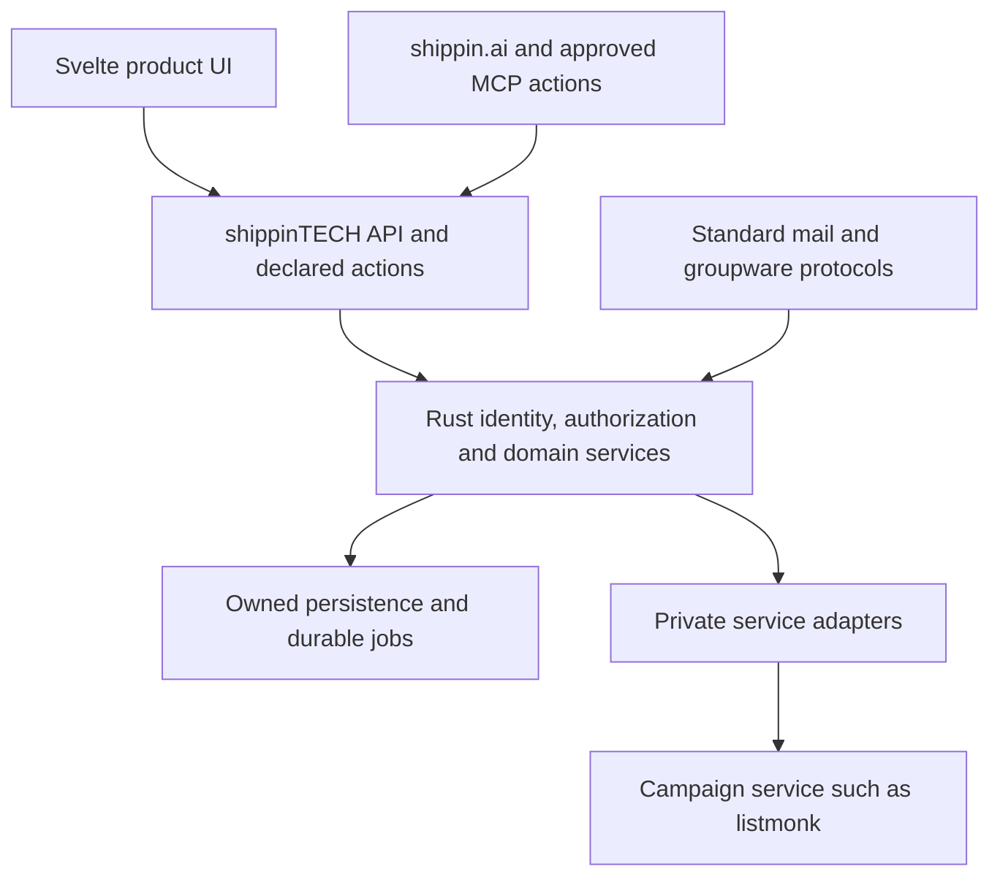

# shippinTECH ownership and product boundary

Owner direction, updated 2026-11-21. This is the target and its acceptance criteria, not a claim
that the current fork is independent. [ROADMAP.md](../ROADMAP.md) owns sequencing;
[REGRESSION.md](../REGRESSION.md) owns the capability floor. No release is authorized.

## End state

shippinTECH owns the complete product: Svelte screens, Rust application behavior,
public contracts, schema sources and generators, storage model, operations and tests.
There is one product API under `/api/v1`. There is no permanent Stalwart management
API, private extension compatibility layer, bundled upstream UI or inherited engine
required to build or run the finished product.

Standard mail and groupware protocols and all existing features remain supported.
The owner authorizes fresh pre-release installs and breaking private product APIs
and historical data formats; a legacy compatibility/import layer is not required.
New-product messages, attachments, settings, permissions and workflows still need
durability and recovery. PostgreSQL is the initial database; FoundationDB is the
scale option behind the same application boundary. Preserve other storage options.

Svelte presents data, collects input, maintains view state and renders errors. Rust
validates commands, authorizes tenant and resource access, controls concurrency and
durable jobs, and records audit outcomes. Hiding a button is never authorization.
Human UI actions and approved agent actions invoke the same application operations.

The current REST-to-JMAP-registry facade is a transition implementation. Its inherited
`x:` methods, schema and storage types are not the new domain model. Own the schema
source and generator, then derive Rust/TypeScript contracts, API documentation and
action metadata from reviewed declarations. Standard JMAP is an adapter to the owned
model, alongside IMAP, SMTP and DAV; it does not dictate private application structure.
Contract generation, centralized permissions and one event stream remain work to prove.

## Cut from Stalwart first

| Boundary | Required completion evidence |
| --- | --- |
| Baseline | Inventory existing capabilities and fork additions with test evidence now; record the exact upstream revision when known and state comparison limits when unknown |
| Entire WebUI | Every source inventory entry has an owned replacement or a documented retained asset with provenance; full workflow, permissions, error, keyboard, mobile and localization checks pass before bundle retirement |
| API | Every product consumer uses the owned contract; no obsolete management route or private registry extension is needed; negative tests prove retired routes are absent |
| Engine and dependencies | Reuse existing shippinTECH implementations; replace confirmed remaining inherited application components with behavioral proof. Retain individually permitted third-party dependencies with notices. No old engine service or unresolved required application source remains |
| Data | Fresh pre-release installation is allowed. New-product persistence, backup/restore and PostgreSQL-to-FoundationDB transfer preserve content, credentials, settings, ACLs and jobs; interrupted transfer is recoverable |
| Operational behavior | Restart, crash, stalled store, bounded timeouts, queue retries, backup and restore pass against synthetic fixtures; measured performance stays inside recorded thresholds |
| Authorship | Retained code and assets have recorded origin; renaming or generated output does not establish ownership; unresolved provenance blocks the independence claim |

Temporary overlap exists only to compare the replacement with the baseline. Remove
the original after the affected checks pass, and record the removal revision. A
successful alpha with inherited code is an interim milestone, not completion of this
request. No capability gap is waived by this direction.

## Then improve from upstream lessons

After the separation gate, review the [upstream repository](https://github.com/stalwartlabs/stalwart)
as an external source of lessons. For each selected issue or change, record its URL,
revision/date, observable failure, applicable standard or product requirement, our
reproducing test and our independent design. Verify whether it affects shippinTECH
before changing anything. Repository access does not establish an unexposed clean-room
process, and copying or paraphrasing implementation does not establish new authorship.

Current local priorities already include stalled-store recovery (ROADMAP L12),
durable delivery, permission isolation, owned schema generation, and complete webmail.
Those findings need no future upstream merge to be fixed. An ongoing upstream merge
dependency is not part of the finished product.

## Service expansion for shippin.ai

Webmail remains a core shippinTECH capability: threads, search, compose/reply/forward,
drafts, attachments, folders, flags and filtering are preserved and completed. Campaign
services follow the same identity, permission, action, job and audit boundaries.

[Listmonk's documented API](https://listmonk.app/docs/apis/apis/) exposes dashboard
features through JSON HTTP requests with API-user authentication and roles. This makes
a private server adapter feasible; it is not evidence of a working integration here.
Listmonk remains an attributed external service while used. A shippinTECH UI over its
API does not make its implementation shippinTECH-authored.

The proposed first integration owns lists, subscribers, templates, campaign lifecycle
and delivery outcomes in the shippinTECH product contract. The Rust adapter holds service
credentials and translates provider responses; Svelte and shippin.ai receive only the
owned contract. Do not expose a second service dashboard or raw provider API as the
product API. Resolve per-tenant service isolation explicitly; do not assume one shared
API user provides it.

Before enabling campaign sends, prove create/read/update flows, cross-tenant denial,
consent and suppression behavior, unsubscribe, bounce handling, cancellation, retry
deduplication, provider outage recovery and export/restore. Prove that campaign work
cannot starve transactional or mailbox delivery. Agent-initiated sends require the same
server permissions and visible approval as other declared write actions. Synthetic
recipients and throwaway installs only until the release gate closes.

## Evidence tooling delivered with this decision

`scripts/regression.py` rejects empty/unknown selections, keeps partial reports separate,
names omitted suites, requires a recorded local image before live checks, invalidates
live success when the image changes, and rejects empty/ignored engine success. Runner
tests are part of Check. Run `python scripts/regression.py --engine` for all currently
configured suites, or `--only web` for an explicitly partial run.

Even all configured suites passing does not close the baseline, migration, performance,
provider-consent or authorship gates. The runner still needs isolated engine fixtures,
candidate build/start orchestration and replacement-specific evidence integration before
ROADMAP R3 and X3 can be marked complete.

### Observed validation, 2026-11-20

Working tree based on `b335bce18c0683413434d7f9ec918fa9894b6186`, with this change
uncommitted. `python scripts/regression.py` recorded **17 passed, 0 failed, 9 not run,
2 omitted** in `roadmap/regression-results.partial.json`; logs are under
`roadmap/runs/20261120T203054Z/`. Its exit status was 1, as required for incomplete coverage.

- Runner: 10 tests passed; included in Check.
- Web: lint, typecheck, 261 unit tests, static build, 12 mocked browser tests,
  brand/API/inventory/MCPL/registry and runnable deploy checks passed.
- Deploy relay test: not run on Windows because it requires POSIX permissions.
- All eight live checks: not run because the local engine did not answer. Subsequent
  Docker inspection showed the complete local stack stopped, with mail exit code 0.
  Inspected mail image: `sha256:474b11762341c1d2c97dd1048bb751e9b115d687fbcb350af9101ea8d45d9754`.
- Inherited engine suites: not run; both are explicitly listed as omitted.
- Operating tree: existing unterminated JSON and missing `concerns` in
  `2026-11-01-suite-readiness.json` still fail the whole-tree check. The new plan passes
  its schema separately. `git diff --check` passes.

The initial web run failed on CRLF in the local `deploy/update.test.sh` checkout.
Normalizing it to the existing `.gitattributes` LF requirement made that check pass;
no test assertion or deployment logic was changed. No engine replacement, API cutover,
listmonk integration, independent authorship or baseline parity is certified by this run.
